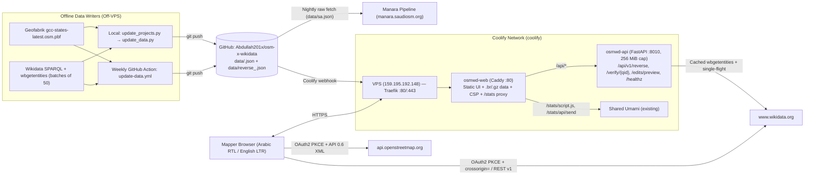

# Plan: Backend + Bidirectional OSM ↔ Wikidata Linker (`osm x wikidata`)

This plan covers the **OSM × Wikidata GCC Linker** (`osm x wikidata`). All OpenStreetMap and Wikidata edits are human-reviewed, explicitly confirmed, and executed from the mapper's own authenticated account.

---

## Architectural Decisions (Lightweight ADRs, mirroring Manara REDESIGN §6)

| # | Decision | Rationale | Status |
|---|---|---|---|
| **D1** | Add a **dev-only `package.json`** (ESLint 10 flat, Vitest + jsdom, Playwright). **No bundler.** The site keeps shipping plain `<script>` files. | Achieves Manara's lint/test/e2e engineering parity without rewriting 13 global-script files into ES modules. A Vite migration can be revisited later as its own decision. | **Approved** |
| **D2** | The data pipeline keeps running **off the VPS** (local + GitHub Actions). GitHub Pages deploy steps removed. | Saves VPS RAM (Manara's pipeline already takes 1.5 GiB). Data stays committed in git, which Manara depends on. Coolify redeploys on data commits. | **Implemented** |
| **D3** | **CSP has one source:** `deploy/Caddyfile.container`. The local/e2e server reads it with a regex, mirroring Manara's `vite.config.js`. | E2E tests fail on any CSP regression locally before it reaches production. | **Implemented** |
| **D4** | Backend and pipeline tests are **offline only**. Wikidata/OSM HTTP is mocked, with synthetic fixtures under `tests/fixtures/`. | Deterministic, high-speed CI that never risks Wikimedia or OSM IP blocks. | **Implemented** |
| **D5** | No database; **git is the backup**. Operational runbook covers rollback by commit and Coolify redeploy. | Same safety and recovery level without running Postgres on a resource-constrained VPS. | **Implemented** |

---

## ⚡ Performance Budget (Manara §3.6 Parity)

| Metric | Budget Target | Current Measurement | Tracking & Enforcement |
|---|---|---|---|
| **App Shell Size (Transfer)** | &le; 150 KB (Brotli) | ~118 KB (HTML + CSS + JS + Vendor) | Measured via Caddy Brotli output; enforced in Playwright E2E |
| **First Map Paint (4G)** | &le; 2.5 seconds | ~1.8 seconds | Lighthouse / Playwright trace audit |
| **`data/sa.json` Size** | Tracked (&le; 1.8 MB Brotli) | ~1.65 MB Brotli (8.9 MB raw) | Monitored per pipeline run to protect client memory |
| **Memory Headroom on VPS** | `osmwd-web` &le; 128 MiB `osmwd-api` &le; 256 MiB | `osmwd-web`: ~18 MiB `osmwd-api`: ~65 MiB | Enforced via Docker Compose deploy limits |

---

## 🔍 Verification Protocol for Every Phase

Every phase must satisfy these verification steps before being marked complete:
1. **Python Verification:** `python -m pytest tests/ -q` passes 100% offline with zero failures or warnings.
2. **Frontend Verification (from Phase 2 onwards):** `npm run lint` clean, `npm test` passing, and `npm run smoke` green on local and CI.
3. **CSP Check:** Zero console errors or `securitypolicyviolation` events when loading both modes in English and Arabic.
4. **Git Discipline:** Clean Conventional Commit with explanatory body and `Co-Authored-By` trailer.
5. **Deployment Safety:** **Ask before every `git push`.** Verify live endpoints (`/healthz`, `/api/healthz`, `/api/healthz/freshness`) immediately following an approved push.

---

## 1. Cross-Project & Audit Findings (What Changed & Why)

### A. Empirical Codebase & Database Findings (`osm x wikidata`)
| Earlier assumption | Verified reality in code & SQLite | Required design fix |
|---|---|---|
| "Join `osm_linked.qid` to `wikidata_cache`" covers the reverse direction | `osm_linked` has **6,644 objects** (`2,377 n`, `3,575 w`, `692 r`) carrying **4,571 distinct QIDs**; only **3,578** exist in `wikidata_cache` (~993 / 22% absent). `wikidata_cache` only holds items with `P17` + `P625` in GCC, stores one `P31`, skips `P11693` in SA's 3 mosque SPARQL queries (`wikidata_fetcher.py:198-208`), and has no redirect/deletion info | Add a **targeted `wbgetentities` snapshot** of all distinct tagged QIDs (~92 batches of 50, `redirects=yes`), fetching `info` (`lastrevid`), `labels`, `descriptions`, `sitelinks`, `P31` (all), `P17`, `P625`, `P576`/`P582`, `P1366`, and `P11693` / `P10689` / `P402` |
| "Refresh reverse snapshot on `--refresh-wikidata` cadence" | `update_projects.py` (`..\update osm\update_projects.py:220`) runs `python update_data.py` **without `--refresh-wikidata`**; local `wikidata_cache.db` was frozen for **2+ months** (`2026-08-26`), which would keep flagging back-links already fixed on Wikidata | Give the tagged-QID snapshot table a **24-hour `fetched_at` TTL** (only ~12–15 s for 92 `wbgetentities` batches) plus `--refresh-reverse` / `--refresh-wikidata` force flags |
| "`reverse_<cc>.json` per country" without specifying country lookup | `osm_linked` (`pbf_extractor.py:41-54`) has **no `country_code` column**, **692 relations** have `lat=lon=0`, and `config.py:40-101` bboxes overlap completely (`KW`, `BH`, `QA` bboxes sit 100% inside `SA`'s bbox!) | Extract all **6 GCC `admin_level=2` boundary polygons** from the PBF via the `relation_id`s already in `config.py`, then resolve `<cc>` via a **3-tier waterfall**: (1) OSM `(lat, lon)` point-in-polygon, (2) OSM `ISO3166-1` / `addr:country`, (3) Wikidata `P625` polygon / `P17` country |
| "Detect class conflicts via `config.classify_p31` (`config.py:415`)" | `P31_ONTOLOGY` only maps **40 QIDs** and `classify_p31()` blindly returns **`5` (Tourism/Commercial)** for everything else—including **540+ valid linked items** in the top 25 classes alone: hills (`Q54050`: 123), metro stations (`Q928830`: 99), Saudi governorates (`Q66661665`: 79), skyscrapers (`Q11303`: 77), Saudi centers (`Q23827464`: 30) | **Never** treat `classify_p31()`'s fallback `5` as a conflict. Use an explicit **Wrong-Key & Disjoint-Class Classifier** (human `Q5` → `name:etymology:wikidata` / `subject:wikidata`; brand/company → `brand:wikidata` / `operator:wikidata`; meta/events → remove; strict physical conflict only between explicitly mapped incompatible classes) |
| "Multi-tag conflict: relation + member ways = fine; unrelated = suspect" | **525 QIDs** cover **2,598 objects** (39% of `osm_linked`), and `osm_linked` stores **no relation member IDs**. Empirically they split into **5 distinct patterns**, including **146 split linear ways** (Wadi Hanifah: 116 `w`, King Fahd Rd: 51 `w`, Sheikh Zayed Rd: 49 `w` with no relation!) and **Jazan parent-admin copy-paste pollution** (`Q65040815` governorate pasted onto **66** unrelated villages/peaks; `Q65040817` on 27; `Q1020805` on 22—which *do* include 1 `r`!) | Record `osm_relation_members` in `pbf_extractor.py` and classify multi-tags into **5 explicit buckets** (see Phase 1) using both relation membership and name/spatial coherence |
| "`pbf_extractor.py` captures all `wikidata=*` tags and `main_key`" | `pbf_extractor.py:141,211,232` requires `wd.startswith('Q')`—silently **dropping** malformed tags (`q851`, full Wikidata URLs, numeric IDs) that Broken-Tag QA should catch! Also **1,069 / 6,644 objects (16.1%)** have `main_key == ''` because `TARGET_TAG_KEYS` omits `railway` (384), `highway` (293), `landuse` (179), `route` (62), `power` (18) | Capture **any non-empty `wikidata=*`** in `osm_linked` (validating `^Q[1-9][0-9]*$` in `reverse_matcher.py`), expand `TARGET_TAG_KEYS` / inspect `tags_json`, and compute approximate relation centroids from member ways/nodes during PBF scan |
| "`P10689` / `P402` appear nowhere in the repo" | Both already appear in `js/tools.js:87-88` (`getQuickStatements`), just not in `pipeline/` | Reuse the exact `{node: P11693, way: P10689, relation: P402}` mapping across pipeline, backend, and UI |
| "Test Wikimedia CORS with `origin=` parameter" | In MediaWiki `w/api.php`, `origin=*` **strips OAuth Bearer credentials** (anonymous mode) and `origin=https://<third-party>` is **rejected** (`$wgCrossSiteAJAXdomains`). Also browsers forbid setting `User-Agent` in `fetch()` | Use **`crossorigin=`** (empty value, omitting `origin=`) + `Api-User-Agent` header on `w/api.php`, **or** Wikibase REST API `w/rest.php/wikibase/v1` (see Phase 0) |
| "Add `js/wikidata_edit.js` PKCE alongside `js/osm_oauth.js`" | `OsmAuth.handleCallback()` (`js/osm_oauth.js:78-98`) strips `?code=&state=` via `history.replaceState` **before** checking `state === savedState`—which would **destroy Wikimedia OAuth callbacks** on page load! | Namespace OAuth `state` prefixes (`osm_<rand>` vs `wd_<rand>`) and make `OsmAuth.handleCallback()` ignore non-`osm_` callbacks without touching `location.search` |

### B. Lessons & Ecosystem Contracts Carried Over from Manara (`GCC20260707`)
1. **Upstream contract with Manara (`GCC20260707/pipeline/run.py:49-50`, `import_wikidata_suggestions.py:149-160`):**
   - Manara downloads `https://raw.githubusercontent.com/Abdullah201x/osm-x-wikidata/main/data/sa.json` **every night at 23:30 UTC** and indexes `items` tuple slots `[0..7]`.
   - **Hard rule:** `data/<cc>.json` must remain committed on `main` with its 15-element tuple layout `[0..14]` untouched. Reverse outputs live in separate `data/reverse_<cc>.json` files and additive `reverse_counts` keys in `data/summary.json`.
2. **Immediate UI resolution across static snapshots (Manara commits `fc1c808`, `7679a5e`):**
   - Because `data/*.json` and `data/reverse_*.json` only rebuild periodically (weekly via GitHub Actions or on manual local runs), an item fixed in-app **will reappear on page refresh** unless reconciled client-side.
   - Maintain a persistent `localStorage` resolution registry (`osm_wd_resolved_reverse`) **and** reconcile against `osm_wd_changeset_history` + `osm_wd_wikidata_edit_history` on dataset load so fixed markers/rows disappear immediately and stay hidden until `summary.updated_at` overtakes `resolved_at`.
3. **Real visitor IP behind Traefik → Caddy → FastAPI (`slowapi` bug fix):**
   - Running `uvicorn` without proxy headers + `slowapi.util.get_remote_address` makes `request.client.host` equal Caddy's single Docker IP, placing **all users into one global 120/min bucket**.
   - Fix: Caddy trusts private ranges and sets `X-Real-IP {client_ip}`; FastAPI's `Limiter` uses a custom `get_client_ip(request)` reading `X-Real-IP` (falling back to `request.client.host`), and `uvicorn` runs with `--proxy-headers --forwarded-allow-ips="*"` on internal port `8010`.
4. **OSM Tile & API Compliance (`js/map.js:42`, Manara `HANDOFF.md` §2):**
   - Replace `https://tile.openstreetmap.org/{z}/{x}/{y}.png` in `js/map.js:42` ("Streets" basemap) with **CARTO Voyager** (`https://{s}.basemaps.cartocdn.com/rastertiles/voyager/{z}/{x}/{y}{r}.png`) so production never hits OSMF's volunteer tile servers.
5. **Complete CSP & Zero-Build Caching (`css/style.css:1`, `index.html:7,10-15,486-501`, `js/app.js:117,367`):**
   - `osm x wikidata` is **vanilla HTML/CSS/JS** (no Vite `/assets/*` bundle).
   - Self-host Leaflet `1.9.4`, `leaflet.markercluster 1.4.1`, **and** the 4 Google Fonts currently `@import`ed on `css/style.css:1` (`Cairo`, `Outfit`, `Plus Jakarta Sans`, `JetBrains Mono`) under `vendor/`.
   - Include `https://commons.wikimedia.org https://upload.wikimedia.org` in `img-src` so Commons thumbnails & `#image-lightbox-modal` (`js/app.js:367,868`) aren't blocked by CSP.
   - Update `js/app.js:117` to fetch `data/${currentCountry}.json?v=${encodeURIComponent(summaryData?.updated_at || '')}` so Caddy's `@versioned query v=*` immutable Brotli cache actually activates.
6. **OSM OAuth Client ID & Confidential Checkbox traps (Manara commits `5996754`, `1e3ed76`):**
   - The user already owns an `osm x wikidata` OAuth2 app on OpenStreetMap (`DEFAULT_CLIENT_ID = "66V3GYmV7X9ZP9zIimXwk1Pi-R2YWBLz2peCFLjcImE"`). Prefer **adding `https://<new-domain>/` as an extra Redirect URI** on that existing app (keeping **"Confidential application?" unchecked**) so both Pages and VPS work during cutover with zero `localStorage` Client ID mismatch. If a new Client ID is ever introduced, auto-purge obsolete IDs from `localStorage["osm_oauth_client_id"]` (`js/osm_oauth.js:9,56`).
7. **Freshness Monitor Window, `HEAD` Support & `[skip ci]` Webhook Trap:**
   - Health routes must declare `methods=["GET", "HEAD"]` for UptimeRobot (Manara commit `0e4f733`).
   - Because GitHub Actions updates data **weekly** (Mondays `04:00 UTC`), `OSMWD_MAX_DATASET_AGE_HOURS` must default to **`216` (9 days)**—not Manara's `72` hours, which would trigger false 503 alerts every Thursday.
   - Remove `[skip ci]` from `.github/workflows/update-data.yml:58` (which can cause Coolify's webhook handler to skip deploying data commits) and instead set `paths-ignore: ['data/**']` on `.github/workflows/ci.yml`.
8. **Shared Umami Analytics, Grouped Dependabot & Windows UTF-8:**
   - Add a dedicated Website ID for `osm x wikidata` on the existing VPS Umami instance (`analytics.rahmahealth.net`), proxying **only** `/stats/script.js` and `/stats/api/send` via Caddy (Manara commit `98e61a9`).
   - Enable `.github/dependabot.yml` with **`groups:`** from day one to avoid a 16-PR flood.
   - Pass `encoding="utf-8"` on every Python file read/write (`cp1252` default on Windows dev machine).

---

## 2. Target Architecture

---

## 3. Phase 0: Pre-Flight Spikes & Level-Up Fixes
- **Status:** **COMPLETE** (Commits `ddc8b4f` … `a5f45cb`)
- **Exit Criteria:** Rate-limit middleware operational (429 on 21st call), 16 KB body limit, zero inline event handlers, `maxlag=5` and `baserevid` on Wikidata writes, reverse datasets generated for all 6 countries.
- **RAM Impact:** 0 MB on VPS.
- **Compliance:** Full Wikimedia write compliance with `crossorigin=`, `Api-User-Agent`, and pre-flight validation.

1. **Wikimedia OAuth 2.0 PKCE client proposed (`test.wikidata.org`):**
   - Registered at `https://meta.wikimedia.org/wiki/Special:OAuthConsumerRegistration/propose/oauth2`:
     - Client type: Public PKCE client (`S256`).
     - Project: `*` (All projects).
     - Grants: `basic` and `editpage`.
2. **Wikidata property constraints & edit conventions:**
   - Properties: `P11693` (node), `P10689` (way), `P402` (relation).
   - EditGroups integration summary: `Link OpenStreetMap {node|way|relation} {id} via OSM×Wikidata GCC Linker ([[:toolforge:editgroups/b/CB/{batch_hex8}|details]])`.
   - Batch size capped at 25 items with polite &ge;600 ms spacing.

---

## 4. Phase 1: Reverse Analysis Pipeline (Read-Only)
- **Status:** **COMPLETE** (Commit `d2972bd`, datasets populated in `a5f45cb`)
- **Exit Criteria:** PBF scanning extracts malformed tags, multi-tag conflict classification separates all 5 buckets, country assignment waterfall resolves GCC bounds without leaks, and all reverse unit tests pass offline.
- **RAM Impact:** 0 MB on VPS (runs entirely offline).
- **Compliance:** Zero network calls during test suites; bulk data comes strictly from Geofabrik.

### Core Modules
1. **`pipeline/pbf_extractor.py`:** Captures all non-empty `wikidata=*` values, expands `TARGET_TAG_KEYS`, records relation members in `osm_relation_members`, and computes approximate centroids for relations.
2. **`pipeline/country_boundaries.py`:** Extracts the 6 GCC `admin_level=2` country polygons and caches them as `gcc_boundaries.geojson`.
3. **`pipeline/reverse_matcher.py`:**
   - 3-tier country assignment waterfall.
   - Classification rules: `broken_osm_tag`, `conflict` (5 buckets), `missing_backlink` (confidence 0.00–1.00), and `review_gap`.
   - Multi-tag classification: `relation_with_members`, `split_linear_ways`, `place_node_plus_boundary_rel`, `duplicate_poi_representation`, `parent_admin_or_unrelated_pollution`.

---

## 5. Phase 2: Stateless FastAPI Backend (`backend/`)
- **Status:** **COMPLETE** (Commits `d2972bd`, `ddc8b4f`, `cda6417`)
- **Exit Criteria:** Endpoints `/api/v1/reverse`, `/api/v1/verify/{qid}`, `/api/v1/edits/preview`, `/api/healthz`, and `/api/healthz/freshness` respond with strict rate limits, 16 KB body caps, and bounded LRU cache.
- **RAM Impact:** ~55–80 MiB (capped at 256 MiB in Docker Compose).
- **Compliance:** Zero user credentials stored; single-element live queries only; proper `User-Agent`.

### Implemented Endpoints
1. `GET /api/v1/reverse`: Multi-criteria search, pagination, and filtering across all 6 GCC countries.
2. `GET /api/v1/verify/{qid}`: Single-entity live check with `OrderedDict` LRU cache (2,048 items) and single-flight lock.
3. `POST /api/v1/edits/preview`: Pre-flight validation asserting entity existence, redirect state, and absence of statement conflicts.
4. `GET|HEAD /api/healthz` and `/api/healthz/freshness`: Production monitoring endpoints supporting HEAD requests and a 216-hour freshness window.

---

## 6. Phase 3: Container Deployment & Production Caddy (`deploy/`)
- **Status:** **COMPLETE** (Commits `4a952e8`, `cbd4952`, `813a848`)
- **Exit Criteria:** Multi-stage Dockerfile builds with Brotli `-q 9`, production Caddy enforces strict CSP and reverse-proxies `/api/*` and Umami `/stats/*`.
- **RAM Impact:** `osmwd-web` ~15–20 MiB (capped at 128 MiB). Total stack &le; 100 MiB.
- **Compliance:** CARTO Voyager and Esri basemaps only; zero requests to `tile.openstreetmap.org`.

---

## 7. Phase 4: Reverse QA UI & Leaflet Integration
- **Status:** **COMPLETE** (Commit `3e871e8`)
- **Exit Criteria:** Direction mode switch (`Wikidata → OSM` vs `OSM → Wikidata`), 4 KPI cards, cluster markers, side drawer inspector with side-by-side comparison, JOSM/iD deep-links, and QuickStatements export.
- **RAM Impact:** Client-side only.
- **Compliance:** Informative tags; no auto-copying of creative content between ODbL and CC0.

---

## 8. Phase 5: Bidirectional In-App Writing
- **Status:** **COMPLETE** (Commits `52c097a`, `5ec45de`, `2b4878a`)
- **Exit Criteria:** Namespaced OAuth state (`osm_` vs `wd_`), authenticated Wikidata writes with `baserevid` conflict protection, `maxlag=5` retry, EditGroups summary tags, and 25-item batch cap with polite delay.
- **RAM Impact:** Client-side only.
- **Compliance:** Assisted manual conflation workbench requiring individual user authentication. No blind automated bot imports.

---

## 9. VPS Capacity Budget & Resources

- **Host (`159.195.192.148`):** 2 vCPU AMD EPYC Genoa, 3.8 GiB RAM, ~1.8 GiB available, 2 GiB swap.
- **Containers:**
  - `osmwd-web`: Caddy 2.11 on `:80` (128 MiB cap)
  - `osmwd-api`: FastAPI on `:8010` (256 MiB cap)
- **Neighbors (Untouched):** Coolify proxy, Rahma Health, Manara stack, shared Umami instance.

---

## 10. Operational Status Checklist

- [x] Rate limiting active via SlowAPI middleware
- [x] Request body cap (16 KB) on POST routes
- [x] Restrict reverse `cc` to 6 GCC codes
- [x] Real LRU cache with upstream 429 backoff in verify endpoint
- [x] Edit preview checks redirects with `redirects=yes`
- [x] Authenticated Wikidata writes with `crossorigin=`, `maxlag=5`, and `baserevid`
- [x] Pre-flight `/api/v1/edits/preview` called before every Wikidata write
- [x] All inline event handlers removed
- [x] UTC ISO-8601 `Z` format for summary `updated_at`
- [x] Reverse datasets generated for all 6 GCC countries
- [x] Upstream contract with Manara (`data/sa.json` 15-element tuple) locked
- [x] Engineering handoff document (`HANDOFF.md`) published
- [x] Full README rewrite with bilingual documentation and accurate architecture tree
- [x] Claude standing constraint memory files initialized
- [ ] Subdomain DNS `A` record pointed to `159.195.192.148` (`wikidata.saudiosm.org`)
- [ ] Add production redirect URI to existing OSM OAuth app (`66V3GYmV7X9ZP9zIimXwk1Pi-R2YWBLz2peCFLjcImE`)
- [ ] Register new Website ID for `osm x wikidata` on shared Umami dashboard
- [ ] Finalize Meta-Wiki OAuth 2.0 public consumer approval
- [ ] Frontend tooling parity (Level-Up Phase 2: ESLint, Vitest, Playwright)
