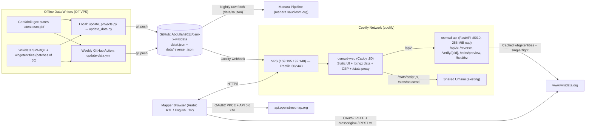

# Plan: Backend + Bidirectional OSM ↔ Wikidata Linker (`osm x wikidata`)

This plan covers the **OSM × Wikidata GCC Linker** (`osm x wikidata`) only. All OpenStreetMap and Wikidata edits are human-reviewed, explicitly confirmed, and executed from the mapper's own authenticated account.

**Core architectural decisions (settled):**
1. **Move the whole site from GitHub Pages to the VPS** behind Coolify's Traefik edge proxy, mirroring Manara (`GCC20260707` / `manara.saudiosm.org`).
2. **Keep the data pipeline off the VPS** (local `update_projects.py` + weekly GitHub Action `.github/workflows/update-data.yml`), committing `data/*.json` and `data/reverse_*.json` to `main`.
3. **Stateless FastAPI backend (`osmwd-api`, no Postgres):** serves filtered reverse-QA queries, live Wikidata/OSM verification with a proper `User-Agent` and bounded cache, and pure pre-flight edit validation (`/api/v1/edits/preview`). Holds **zero user tokens or secrets**.

This revision incorporates:
- Full code & SQLite audit of `osm x wikidata` (`pipeline/osm_cache.db`, `pipeline/wikidata_cache.db`, `js/*`, `index.html`, `css/style.css`, `.github/workflows/update-data.yml`).
- Hard-won production lessons, bug fixes, and operational conventions from **Manara (`C:\Users\abdul\Desktop\GCC20260707`)**.
- Pre-verified MediaWiki OAuth 2.0 / Wikibase API CORS & property specifications.

---

## 1. Cross-Project & Audit Findings (What Changed & Why)

### A. Empirical Codebase & Database Findings (`osm x wikidata`)
| Earlier assumption | Verified reality in code & SQLite | Required design fix |
|---|---|---|
| "Join `osm_linked.qid` to `wikidata_cache`" covers the reverse direction | `osm_linked` has **6,644 objects** (`2,377 n`, `3,575 w`, `692 r`) carrying **4,571 distinct QIDs**; only **3,578** exist in `wikidata_cache` (~993 / 22% absent). `wikidata_cache` only holds items with `P17` + `P625` in GCC, stores one `P31`, skips `P11693` in SA's 3 mosque SPARQL queries (`wikidata_fetcher.py:198-208`), and has no redirect/deletion info | Add a **targeted `wbgetentities` snapshot** of all distinct tagged QIDs (~92 batches of 50, `redirects=yes`), fetching `info` (`lastrevid`), `labels`, `descriptions`, `sitelinks`, `P31` (all), `P17`, `P625`, `P576`/`P582`, `P1366`, and `P11693` / `P10689` / `P402` |
| "Refresh reverse snapshot on `--refresh-wikidata` cadence" | `update_projects.py` (`..\update osm\update_projects.py:220`) runs `python update_data.py` **without `--refresh-wikidata`**; local `wikidata_cache.db` was frozen for **2+ months** (`2026-08-26`), which would keep flagging back-links already fixed on Wikidata | Give the tagged-QID snapshot table a **24-hour `fetched_at` TTL** (only ~12–15 s for 92 `wbgetentities` batches) plus `--refresh-reverse` / `--refresh-wikidata` force flags |
| "`reverse_<cc>.json` per country" without specifying country lookup | `osm_linked` (`pbf_extractor.py:41-54`) has **no `country_code` column**, **692 relations** have `lat=lon=0`, and `config.py:40-101` bboxes overlap completely (`KW`, `BH`, `QA` bboxes sit 100% inside `SA`'s bbox!) | Extract all **6 GCC `admin_level=2` boundary polygons** from the PBF via the `relation_id`s already in `config.py`, then resolve `<cc>` via a **3-tier waterfall**: (1) OSM `(lat, lon)` point-in-polygon, (2) OSM `ISO3166-1` / `addr:country`, (3) Wikidata `P625` polygon / `P17` country |
| "Detect class conflicts via `config.classify_p31` (`config.py:415`)" | `P31_ONTOLOGY` only maps **40 QIDs** and `classify_p31()` blindly returns **`5` (Tourism/Commercial)** for everything else—including **540+ valid linked items** in the top 25 classes alone: hills (`Q54050`: 123), metro stations (`Q928830`: 99), Saudi governorates (`Q66661665`: 79), skyscrapers (`Q11303`: 77), Saudi centers (`Q23827464`: 30) | **Never** treat `classify_p31()`'s fallback `5` as a conflict. Use an explicit **Wrong-Key & Disjoint-Class Classifier** (human `Q5` → `name:etymology:wikidata` / `subject:wikidata`; brand/company → `brand:wikidata` / `operator:wikidata`; meta/events → remove; strict physical conflict only between explicitly mapped incompatible classes) |
| "Multi-tag conflict: relation + member ways = fine; unrelated = suspect" | **525 QIDs** cover **2,598 objects** (39% of `osm_linked`), and `osm_linked` stores **no relation member IDs**. Empirically they split into **5 distinct patterns**, including **146 split linear ways** (Wadi Hanifah: 116 `w`, King Fahd Rd: 51 `w`, Sheikh Zayed Rd: 49 `w` with no relation!) and **Jazan parent-admin copy-paste pollution** (`Q65040815` governorate pasted onto **66** unrelated villages/peaks; `Q65040817` on 27; `Q1020805` on 22—which *do* include 1 `r`!) | Record `osm_relation_members` in `pbf_extractor.py` and classify multi-tags into **5 explicit buckets** (see Phase 1) using both relation membership and name/spatial coherence |
| "`pbf_extractor.py` captures all `wikidata=*` tags and `main_key`" | `pbf_extractor.py:141,211,232` requires `wd.startswith('Q')`—silently **dropping** malformed tags (`q851`, full Wikidata URLs, numeric IDs) that Broken-Tag QA should catch! Also **1,069 / 6,644 objects (16.1%)** have `main_key == ''` because `TARGET_TAG_KEYS` omits `railway` (384), `highway` (293), `landuse` (179), `route` (62), `power` (18) | Capture **any non-empty `wikidata=*`** in `osm_linked` (validating `^Q[1-9][0-9]*$` in `reverse_matcher.py`), expand `TARGET_TAG_KEYS` / inspect `tags_json`, and compute approximate relation centroids from member ways/nodes during PBF scan |
| "`P10689` / `P402` appear nowhere in the repo" | Both already appear in `js/tools.js:87-88` (`getQuickStatements`), just not in `pipeline/` | Reuse the exact `{node: P11693, way: P10689, relation: P402}` mapping across pipeline, backend, and UI |
| "Test Wikimedia CORS with `origin=` parameter" | In MediaWiki `w/api.php`, `origin=*` **strips OAuth Bearer credentials** (anonymous mode) and `origin=https://<third-party>` is **rejected** (`$wgCrossSiteAJAXdomains`). Also browsers forbid setting `User-Agent` in `fetch()` | Use **`crossorigin=`** (empty value, omitting `origin=`) + `Api-User-Agent` header on `w/api.php`, **or** Wikibase REST API `w/rest.php/wikibase/v1` (see Phase 0) |
| "Add `js/wikidata_edit.js` PKCE alongside `js/osm_oauth.js`" | `OsmAuth.handleCallback()` (`js/osm_oauth.js:78-98`) strips `?code=&state=` via `history.replaceState` **before** checking `state === savedState`—which would **destroy Wikimedia OAuth callbacks** on page load! | Namespace OAuth `state` prefixes (`osm_<rand>` vs `wd_<rand>`) and make `OsmAuth.handleCallback()` ignore non-`osm_` callbacks without touching `location.search` |

### B. Lessons & Ecosystem Contracts Carried Over from Manara (`GCC20260707`)
1. **Upstream contract with Manara (`GCC20260707/pipeline/run.py:49-50`, `import_wikidata_suggestions.py:149-160`):**
   - Manara downloads `https://raw.githubusercontent.com/Abdullah201x/osm-x-wikidata/main/data/sa.json` **every night at 23:30 UTC** and indexes `items` tuple slots `[0..7]`.
   - **Hard rule:** `data/<cc>.json` must remain committed on `main` with its 15-element tuple layout `[0..14]` untouched. Reverse outputs live in separate `data/reverse_<cc>.json` files and additive `reverse_counts` keys in `data/summary.json`.
2. **Immediate UI resolution across static snapshots (Manara commits `fc1c808`, `7679a5e`):**
   - Because `data/*.json` and `data/reverse_*.json` only rebuild periodically (weekly via GitHub Actions or on manual local runs), an item fixed in-app **will reappear on page refresh** unless reconciled client-side.
   - Maintain a persistent `localStorage` resolution registry (`osm_wd_resolved_reverse`) **and** reconcile against `osm_wd_changeset_history` + `osm_wd_wikidata_edit_history` on dataset load so fixed markers/rows disappear immediately and stay hidden until `summary.updated_at` overtakes `resolved_at`.
3. **Real visitor IP behind Traefik → Caddy → FastAPI (`slowapi` bug fix):**
   - Running `uvicorn` without proxy headers + `slowapi.util.get_remote_address` makes `request.client.host` equal Caddy's single Docker IP, placing **all users into one global 120/min bucket**.
   - Fix: Caddy trusts private ranges and sets `X-Real-IP {client_ip}`; FastAPI's `Limiter` uses a custom `get_client_ip(request)` reading `X-Real-IP` (falling back to `request.client.host`), and `uvicorn` runs with `--proxy-headers --forwarded-allow-ips="*"` on internal port `8010`.
4. **OSM Tile & API Compliance (`js/map.js:42`, Manara `HANDOFF.md` §2):**
   - Replace `https://tile.openstreetmap.org/{z}/{x}/{y}.png` in `js/map.js:42` ("Streets" basemap) with **CARTO Voyager** (`https://{s}.basemaps.cartocdn.com/rastertiles/voyager/{z}/{x}/{y}{r}.png`) so production never hits OSMF's volunteer tile servers.
5. **Complete CSP & Zero-Build Caching (`css/style.css:1`, `index.html:7,10-15,486-501`, `js/app.js:117,367`):**
   - `osm x wikidata` is **vanilla HTML/CSS/JS** (no Vite `/assets/*` bundle).
   - Self-host Leaflet `1.9.4`, `leaflet.markercluster 1.4.1`, **and** the 4 Google Fonts currently `@import`ed on `css/style.css:1` (`Cairo`, `Outfit`, `Plus Jakarta Sans`, `JetBrains Mono`) under `vendor/`.
   - Include `https://commons.wikimedia.org https://upload.wikimedia.org` in `img-src` so Commons thumbnails & `#image-lightbox-modal` (`js/app.js:367,868`) aren't blocked by CSP.
   - Update `js/app.js:117` to fetch `data/${currentCountry}.json?v=${encodeURIComponent(summaryData?.updated_at || '')}` so Caddy's `@versioned query v=*` immutable Brotli cache actually activates.
6. **OSM OAuth Client ID & Confidential Checkbox traps (Manara commits `5996754`, `1e3ed76`):**
   - The user already owns an `osm x wikidata` OAuth2 app on OpenStreetMap (`DEFAULT_CLIENT_ID = "66V3GYmV7X9ZP9zIimXwk1Pi-R2YWBLz2peCFLjcImE"`). Prefer **adding `https://<new-domain>/` as an extra Redirect URI** on that existing app (keeping **"Confidential application?" unchecked**) so both Pages and VPS work during cutover with zero `localStorage` Client ID mismatch. If a new Client ID is ever introduced, auto-purge obsolete IDs from `localStorage["osm_oauth_client_id"]` (`js/osm_oauth.js:9,56`).
7. **Freshness Monitor Window, `HEAD` Support & `[skip ci]` Webhook Trap:**
   - Health routes must declare `methods=["GET", "HEAD"]` for UptimeRobot (Manara commit `0e4f733`).
   - Because GitHub Actions updates data **weekly** (Mondays `04:00 UTC`), `OSMWD_MAX_DATASET_AGE_HOURS` must default to **`216` (9 days)**—not Manara's `72` hours, which would trigger false 503 alerts every Thursday.
   - Remove `[skip ci]` from `.github/workflows/update-data.yml:58` (which can cause Coolify's webhook handler to skip deploying data commits) and instead set `paths-ignore: ['data/**']` on `.github/workflows/ci.yml`.
8. **Shared Umami Analytics, Grouped Dependabot & Windows UTF-8:**
   - Add a dedicated Website ID for `osm x wikidata` on the existing VPS Umami instance (`analytics.rahmahealth.net`), proxying **only** `/stats/script.js` and `/stats/api/send` via Caddy (Manara commit `98e61a9`).
   - Enable `.github/dependabot.yml` with **`groups:`** from day one to avoid a 16-PR flood.
   - Pass `encoding="utf-8"` on every Python file read/write (`cp1252` default on Windows dev machine).

---

## 2. Target Architecture

---

## 3. Phase 0: Pre-Flight Spikes (Gate Phase 5 Only; Phases 1–4 Can Proceed)

> **Propose the Wikimedia OAuth 2.0 consumer on Day 1:** On `meta.wikimedia.org`, unapproved OAuth 2.0 consumers work immediately for the **owner's account** (allowing full Phase 0 and Phase 5 testing on `test.wikidata.org`), while public mapper login awaits Meta-Wiki OAuth admin approval (typically 1–7 days). Submitting early runs approval in parallel with Phases 1–4.

1. **Propose & test Wikimedia OAuth 2.0 public PKCE client (`test.wikidata.org`):**
   - Register at `https://meta.wikimedia.org/wiki/Special:OAuthConsumerRegistration/propose/oauth2`:
     - **Client type:** Non-confidential / Public client (**uncheck** confidential client; PKCE `S256` required).
     - **Applicable project:** **`*` (All projects)** — mandatory so the same client works on both `test.wikidata.org` and `www.wikidata.org`.
     - **Callback URL:** `https://<chosen-subdomain>/` (exact trailing-slash match).
     - **Grants / Scopes:** `basic` and `editpage` only (least privilege).
   - Verify full browser round-trip from the new domain (or `https://localhost:8000/`) against **`test.wikidata.org`**:
     - Authorization: `https://meta.wikimedia.org/w/rest.php/oauth2/authorize` (or `test.wikidata.org/w/rest.php/oauth2/authorize`).
     - Token exchange: `POST .../w/rest.php/oauth2/access_token` (`Content-Type: application/x-www-form-urlencoded`, no `credentials: 'include'`, note 4-hour `access_token` TTL + `refresh_token`).
     - **Authenticated CORS write check (test both official paths, pick the cleaner one):**
       - **Path A (Wikibase Action API):** `GET https://test.wikidata.org/w/api.php?action=query&meta=tokens&type=csrf&format=json&crossorigin=` (note: **`crossorigin=`**, **never** `origin=*`), headers `Authorization: Bearer <token>` and `Api-User-Agent: OSMxWikidataLinker/2.0 (+https://<domain>)`, followed by `POST .../w/api.php?format=json&crossorigin=` with `action=wbcreateclaim`, `snaktype=value`, `property=P11693`, `value="\"12345\""` (JSON-encoded string!), `baserevid`, `maxlag=5`, `summary`, `token`.
       - **Path B (Wikibase REST API v1):** `POST https://test.wikidata.org/w/rest.php/wikibase/v1/entities/items/{qid}/statements` with `Authorization: Bearer <token>` and JSON payload (no separate CSRF round-trip, atomic statement + optional reference + `comment`).
     - **Fallback (only if browser CORS fails on both):** stateless single-request forwarder on `osmwd-api` receiving the user's Bearer token in `Authorization`, forwarding once to Wikidata, and never logging or persisting it.
2. **Confirm Wikidata property constraints & edit conventions:**
   - Properties (all datatype `external-id`, format regex `^[1-9][0-9]*$`):
     - **`P11693`**: OpenStreetMap node ID (`https://www.openstreetmap.org/node/$1`)
     - **`P10689`**: OpenStreetMap way ID (`https://www.openstreetmap.org/way/$1`) — Single-Value + Distinct-Value constraints
     - **`P402`**: OpenStreetMap relation ID (`https://www.openstreetmap.org/relation/$1`) — Single-Value + Distinct-Value constraints
   - **Reference convention:** Self-identifying external-ID pointers on Wikidata normally carry **no reference** (avoiding redundant self-citations and avoiding a 2-revision `wbcreateclaim` + `wbsetreference` split). Confirm against recent community practice on `Property talk:P11693` / `P10689` / `P402`.
   - **EditGroups integration & batch policy:** Use Wikidata's standard **EditGroups** custom-tool summary suffix on every single/batch edit:
     `Link OpenStreetMap {node|way|relation} {id} via OSM×Wikidata GCC Linker ([[:toolforge:editgroups/b/CB/{batch_hex8}|details]])`
     This gives Wikidata patrollers and the user automatic batch grouping and 1-click batch undo on `https://editgroups.toolforge.org`. Cap user-confirmed batches at **25 statements** (`maxlag=5`, ≥600 ms spacing) so edits remain strictly human-reviewed assisted edits rather than unapproved bot runs.

---

## 4. Phase 1: Reverse Analysis Pipeline (Read-Only)

### A. Targeted Upgrades to `pipeline/pbf_extractor.py`
1. **Capture malformed `wikidata=*` values for QA:**
   - Replace `if wd and wd.startswith('Q'):` (`pbf_extractor.py:141,211,232`) with `if wd and wd.strip():` for `osm_linked`.
   - Keep `matcher.py:38-41` filtering to canonical `^Q[1-9][0-9]*$` so forward matching is unaffected, while `reverse_matcher.py` now catches lowercase `q851`, full URLs (`https://www.wikidata.org/wiki/Q851`), `wd:Q851`, numeric IDs, and semicolon lists (`Q1;Q2`).
2. **Expand `TARGET_TAG_KEYS` (`pbf_extractor.py:21-25`):**
   - Add `"highway"`, `"railway"`, `"landuse"`, `"route"`, `"public_transport"`, `"power"`, `"water"`, `"bridge"`, `"military"`, `"barrier"` so the **1,069 currently blank-`main_key` linked objects** get proper `main_key`/`main_val` classification.
3. **Relation membership & approximate centroids for the 692 relations:**
   - Add table `osm_relation_members(rel_id INTEGER, member_type TEXT, member_id INTEGER, role TEXT)` in `osm_cache.db` for relations carrying `wikidata=*` (a few thousand rows).
   - Compute approximate relation `(lat, lon)` after the PBF pass by averaging resolved member node/way coordinates stored in `osm_linked` / a lightweight member-coord map (leaving `(0.0, 0.0)` only when no member geometry resolves in the extract, in which case `reverse_matcher.py` falls back to Wikidata `P625`).
4. **Extract 6 GCC `admin_level=2` country polygons (`pipeline/country_boundaries.py` or inside `pbf_extractor.py`):**
   - Build and cache `pipeline/gcc_boundaries.geojson` (gitignored, invalidated on `pbf_mtime`) from the 6 relation IDs already defined in `config.py:40-101` (`SA: 307584`, `AE: 307763`, `KW: 305099`, `QA: 305095`, `BH: 378734`, `OM: 305138`) using `osmium` + `shapely.prepared.prep` (same pattern proven in Manara's `pipeline/extract_regions.py`).

### B. Tagged-QID Snapshot (`pipeline/reverse_matcher.py`)
- Table `tagged_qid_cache` in `pipeline/wikidata_cache.db` (gitignored):
  - Keyed by canonical `qid`, storing: `status` (`exists` | `redirect` | `missing`), `redirect_target`, `lastrevid`, `labels_json` (`ar`, `en`), `descriptions_json` (`ar`, `en`), `p31_json` (all `P31` QIDs), `p17_json` (all `P17` country QIDs), `lat`, `lon` (`P625`), `p11693_json`, `p10689_json`, `p402_json`, `dissolved` (`P576`/`P582`), `replaced_by` (`P1366`), `sitelinks_json` (`arwiki`, `enwiki`), `fetched_at` (epoch seconds).
- Fetch via `https://www.wikidata.org/w/api.php?action=wbgetentities&ids=...|...&props=info|labels|descriptions|claims|sitelinks&languages=ar|en&redirects=yes&format=json` in **batches of 50**, reusing `USER_AGENT` and exponential backoff (`429`/`503` `Retry-After`) from `wikidata_fetcher.py`.
- **Refresh policy:** Refresh QIDs missing from `tagged_qid_cache` or with `now - fetched_at > 86400` (24 h), or all QIDs when `--refresh-wikidata` / `--refresh-reverse` is passed. Never wipe existing cached rows if Wikidata returns a transient network error.

### C. Country Assignment Waterfall (`<cc>` in `sa, ae, kw, qa, bh, om`)
1. If OSM `(lat, lon) != (0, 0)`: `shapely` point-in-polygon against the 6 prepared GCC country polygons (with a ~2 km coastal buffer fallback for offshore piers/islands). If outside all 6 GCC countries (border bleed in Iraq/Jordan/Yemen/Iran inside the `12..34 × 33..61` PBF filter), **drop cleanly**.
2. Else check OSM tags `ISO3166-1` / `ISO3166-1:alpha2` / `addr:country` (handles national & provincial boundary relations).
3. Else check Wikidata `P625` against the 6 polygons, then Wikidata `P17` (`QID_TO_COUNTRY_CODE`).

### D. Classification Rules & Confidence Scoring
Called inside `update_data.py` right after country matching so both `update_projects.py` and `.github/workflows/update-data.yml` emit `data/reverse_<cc>.json` and `summary["countries"][CC]["reverse_counts"]`.

1. **Kind `broken_osm_tag` (Fix is on OSM):**
   - `malformed_qid`: syntax fails `^Q[1-9][0-9]*$` (e.g. `q851`, full URL, semicolon `Q1;Q2` — include normalized target suggestion when deterministic).
   - `missing_qid`: Wikidata entity deleted / missing.
   - `redirected_qid`: `wbgetentities` resolved a redirect (`from → to`); 1-click OSM tag replacement suggestion (`wikidata=to`).
   - `wrong_wikidata_key` (actionable migration to secondary `*:wikidata` tag — **hard-blocked from Wikidata back-linking**):
     - `Q5` (human) → suggest `name:etymology:wikidata` (streets/mosques/schools named after people) or `subject:wikidata` (statues/memorials).
     - Brand / business / retail chain classes (`Q431289`, `Q4830453`, `Q783794`, `Q507619`, `Q161726`) or non-GCC `P17` corporate HQ tagged on a branch POI → suggest `brand:wikidata` or `operator:wikidata`.
     - Taxon (`Q16521`) → `species:wikidata`.
   - `non_entity_or_non_physical`: Wikimedia disambiguation (`Q4167410`), category/list/template, or event/incident (`NON_MAPPABLE_P31` from `physicality_filter.py`).
   - `class_conflict`: **only** when at least one `P31` is explicitly in an incompatible physical domain vs OSM `main_key`/`main_val` (never triggered by unknown `P31` classes absent from `P31_ONTOLOGY`).

2. **Kind `conflict` (Multi-tag & ID mismatch classification across all 525 multi-tagged QIDs):**
   - **Pre-classification of multi-tagged QIDs (5 buckets):**
     1. `relation_with_members` (verified via `osm_relation_members` + name coherence, e.g., Haramain Railway `Q737791` = 1 `r` + 270 `w`): **benign** — evaluate `P402` back-link on the `relation` only; suppress member ways from `conflict` and `missing_backlink`.
     2. `split_linear_ways` (2+ `highway`/`railway`/`waterway`/`natural=valley`/coaster `way`s sharing QID + coherent name, e.g., Wadi Hanifah `Q3595382` = 116 `w`, King Fahd Rd `Q12221758` = 51 `w`): **benign OSM segmentation** — suppress `P10689` back-link (respects Wikidata Single-Value Constraint) and omit from error queues (optional info filter).
     3. `place_node_plus_boundary_rel` (`place=*` node + `boundary=administrative` relation sharing QID + name): **benign** — `P11693` and `P402` are distinct properties and both are valid.
     4. `duplicate_poi_representation` (POI `node` + building/area `way` within 150 m sharing QID): flag as **low-severity OSM duplicate representation** (prefer `way` or merge in JOSM/iD).
     5. `parent_admin_or_unrelated_pollution` (**high-value OSM bug**, e.g. Jazan governorates `Q65040815` / `Q65040817` / `Q1020805` pasted onto 16–66 unrelated villages and peaks): non-member objects >500 m apart or with divergent names sharing one QID → flag each mismatched child object for `wikidata=` removal or migration to `is_in:wikidata=`.
   - **Wikidata OSM-ID mismatch (`wd_id_conflict`):**
     - Item already has `P11693` / `P10689` / `P402` pointing to a **different** OSM ID. Distinguish **`stale_node_to_way_upgrade`** (old OSM node no longer exists in `osm_linked`, replaced by traced building way carrying `wikidata=Q…`) from **`active_id_conflict`** (both OSM objects exist).

3. **Kind `missing_backlink` (Fix is on Wikidata: add `P11693`, `P10689`, or `P402`):**
   - Eligible only when: QID `exists` (not redirected/missing), passes `wrong_wikidata_key` & `non_physical` guards, is 1-to-1 for that target property (or canonical parent relation in `relation_with_members`), and Wikidata lacks that property (`P11693`/`P10689`/`P402`).
   - **Confidence score (`0.00–1.00`) & tiers (`high >= 0.85`, `medium 0.60–0.84`, `low < 0.60`):**
     - **Name similarity (up to `0.45`):** `arabic_normalizer.string_similarity` after stripping trailing Wikidata batch serial numbers (`\s+[0-9٠-٩]+$`, e.g., `"جامع الرمال 1" → "جامع الرمال"`), plus cross-script Arabic↔Latin phonetic transliteration fallback when one side is Arabic-only and the other is English-only.
     - **Coordinate proximity (up to `0.35`):** `<50 m → 0.35`, `<150 m → 0.28`, `<500 m → 0.18`, `<2 km (large areas/wadis/settlements) → 0.10`, `>5 km → penalty -0.30` (skipped/rescaled for relations lacking PBF centroid or items lacking `P625`).
     - **Ontology & 1-to-1 exclusivity (up to `0.20`):** positive class agreement + unique tag bonus.
   - Only `high` tier (`>= 0.85`) enables 1-click / batch staging; `medium` and `low` require explicit inspector review.

4. **Kind `review_gap` (Opt-in informational, never auto-copied!):**
   - Item lacks `P625` coordinates or lacks an Arabic label (`name_ar`) while OSM has `name:ar` / Arabic `name` (excluding unnamed/generic OSM objects like bare `"مسجد"` / `"Mosque"`).
   - **Strict licence rule (ODbL vs CC0):** Never auto-copy coordinates or names from OSM into Wikidata. Adding an OSM numeric ID (`P11693`/`P10689`/`P402`) is an external identifier pointer, not copied creative/database content. Keep `review_gap` unchecked by default in the UI so actionable queues stay clean.

### E. Tests & Dependency Hygiene
- Add root `requirements.txt` (fixing `update-data.yml:29` `cache: 'pip'`) and `backend/requirements.txt`.
- Add `pytest.ini` and `tests/test_reverse_matcher.py` using in-memory SQLite fixtures (all `open()` / `read_text()` explicitly `encoding="utf-8"` for Windows `cp1252` safety) covering:
  - 1-to-1 high-confidence missing back-link (including disambiguation suffix `"جامع الرمال 1"`),
  - malformed QID (`q851`, full URL, `Q1;Q2`), missing QID, redirected QID,
  - wrong-key misuse (`Q5` human → `name:etymology:wikidata`, brand → `brand:wikidata`),
  - unmapped valid `P31` (`Q928830` metro station, `Q11303` skyscraper, `Q66661665` Saudi governorate) **not** triggering false class conflict,
  - all 5 multi-tag buckets (`relation_with_members`, `split_linear_ways` like Wadi Hanifah, `place_node_plus_boundary_rel`, `duplicate_poi_representation`, and Jazan `parent_admin_pollution`),
  - country polygon assignment (`KW`/`BH`/`QA` not leaking into `SA`; `(0, 0)` relation resolved via `ISO3166-1` / `P17`).

---

## 5. Phase 2: Stateless FastAPI Backend (`backend/`)

Modelled on Manara's `backend/` (`app/main.py`, `app/routers/`), **without PostgreSQL** — loads `data/summary.json` and `data/reverse_*.json` into memory at startup (`app.state.store`, avoiding Python `from module import None` import-time traps) and hot-reloads atomically if `summary.json`'s `mtime` changes (checked at most once per 60 s).

### Endpoints
1. **`GET /api/v1/reverse`**
   - Query params: `cc` (`sa|ae|kw|qa|bh|om`), `kind` (comma-separated), `subkind`, `min_confidence` (`0..1`), `q` (normalized Arabic/English/QID/OSM-ID search), `bbox` (`minLon,minLat,maxLon,maxLat`), `page` (`1..`), `page_size` (`1..200`, default `50`).
   - Returns `{meta, counts_by_kind, total, page, page_size, items[]}`.
2. **`GET /api/v1/verify/{qid}`**
   - Live check of one `qid` (`^Q[1-9][0-9]*$`) via `wbgetentities` (`exists`, `redirect_target`, `lastrevid`, `labels`, `p31`, `p625`, `p11693`, `p10689`, `p402`), plus optional `?osm_type=node|way|relation&osm_id=...` single-element check against `api.openstreetmap.org/api/0.6/{type}/{id}.json` (verifying the OSM object still exists and still carries `wikidata={qid}` — single user-triggered lookup, zero bulk reads).
   - Uses lifespan-managed `httpx.AsyncClient` with `User-Agent: OSMxWikidataLinker/2.0 (+https://<domain>)`, 6 s timeout, `429 Retry-After` respect, `asyncio` single-flight coalescing lock per key, and bounded LRU TTL cache (2,048 entries, 5-min TTL).
3. **`POST /api/v1/edits/preview`**
   - Pure validation function (sends **zero** writes; holds **zero** tokens).
   - Input: `{qid, property: "P11693"|"P10689"|"P402", osm_type, osm_id}`.
   - Re-fetches live Wikidata entity + live single OSM element (`GET /api/0.6/{osm_type}/{osm_id}.json`), asserting:
     1. Entity exists and is not redirected (`entity.id == qid`);
     2. Entity `P31` is not a human (`Q5`), brand/company chain, disambiguation page (`Q4167410`), or event;
     3. Property matches `osm_type` (`node→P11693`, `way→P10689`, `relation→P402`) and `osm_id` matches `^[1-9][0-9]*$`;
     4. Item does not already have a conflicting statement on that property (returns `status: "already_linked"` if identical ID exists, `status: "conflict"` if different ID exists);
     5. Live OSM element exists (not 404/410 deleted) and currently carries `wikidata == qid` (preventing broken back-links to deleted or re-tagged OSM objects!).
   - Returns `{valid, status, baserevid, property, osm_id, value_json, warnings[]}`.
4. **`GET|HEAD /api/healthz`** and **`GET|HEAD /api/healthz/freshness`**
   - Both explicitly `methods=["GET", "HEAD"]` for UptimeRobot.
   - `/api/healthz/freshness` checks `summary.json` `updated_at` (ISO-8601 UTC) against `OSMWD_MAX_DATASET_AGE_HOURS` (**default `216` hours = 9 days** to match the weekly Monday GitHub Action without false mid-week 503 alarms).

### Security & Resource Limits
- **Real Per-Visitor IP Rate Limiting (`slowapi`):** custom `get_client_ip(request)` reading `X-Real-IP` (set by Caddy from `{client_ip}`) with fallback to `request.client.host`; `uvicorn` started with `--proxy-headers --forwarded-allow-ips="*"` on internal port `8010`.
  - Limits: `120/minute` default, `20/minute` on `/api/v1/verify/{qid}`, `30/minute` on `/api/v1/edits/preview`.
- **Strict CORS & Payload Size:** `allow_origins` restricted to `https://<new-domain>` and `http(s)://localhost:8000`; max request body 16 KB; no cookies, no DB, no secrets.
- **Container Hardening (`backend/Dockerfile`):** pinned `python:3.12-slim`, non-root `USER appuser`, internal `HEALTHCHECK` (`http://127.0.0.1:8010/api/healthz`), Coolify `mem_limit: 256m`.

---

## 6. Phase 3: Move the Site to the VPS (Read-Only Features Ship First)

### Hard VPS & Coolify Rules (Shared with Manara & Rahma Health)
- **Traefik (`coolify-proxy`) owns host ports 80/443.** Never bind host ports 80 or 443.
- **Never touch Rahma Health (`nn0yw94zrb6w7lbgpmzt3jko`) or Manara (`manara-*`) containers.**

### Step-by-Step Deployment Design
1. **Self-host frontend vendor assets (`vendor/`):**
   - Vendor `leaflet@1.9.4` (JS, CSS, marker PNGs), `leaflet.markercluster@1.4.1` (JS, CSS), and `.woff2` subsets for `Cairo`, `Outfit`, `Plus Jakarta Sans`, and `JetBrains Mono` (removing `unpkg.com` from `index.html:10-15,486-488` and `@import url('https://fonts.googleapis.com/...')` from `css/style.css:1`).
   - Replace `tile.openstreetmap.org` in `js/map.js:42` with CARTO Voyager (`https://{s}.basemaps.cartocdn.com/rastertiles/voyager/{z}/{x}/{y}{r}.png`).
   - Update `js/app.js:117` to append `?v=${encodeURIComponent(summaryData?.updated_at || '')}` when fetching `data/<cc>.json` (and `data/reverse_<cc>.json` if fetched directly).
2. **Web Container (`Dockerfile` + `deploy/Caddyfile.container`):**
   - Two-stage `Dockerfile` (no Node/Vite stage needed—vanilla static app):
     - Stage 1 (`alpine:3.24`): copy `index.html`, `css/`, `js/`, `vendor/`, `data/*.json`, and pre-compress static & JSON assets with `gzip -9 -k` and **`brotli -q 9 -k`** (`-q 9` is 5–8× faster than `-q 11` on 9 MB `sa.json` on the 2-vCPU box, within ~2% compression ratio).
     - Stage 2 (`caddy:2.11-alpine`): plain `:80`, `HEALTHCHECK` on `http://127.0.0.1/healthz`, `mem_limit: 128m`.
   - `deploy/Caddyfile.container`:
     - `trusted_proxies static private_ranges` + `client_ip_headers X-Forwarded-For`.
     - `/healthz` → `200`.
     - **Umami same-origin proxy (exact Manara `98e61a9` pattern):** `@umami path /stats/script.js /stats/api/send` → `https://analytics.rahmahealth.net` (strip `/stats`, strip `Cookie`, forward `CF-Connecting-IP` & `True-Client-IP`; `/stats/login` stays 404). Uses a **new dedicated Umami Website ID** for `osm x wikidata`.
     - `/api/*` → `reverse_proxy {$OSMWD_API_URL:http://osmwd-api:8010}` with `header_up X-Real-IP {client_ip}`.
     - `/data/*`: serves `/srv/osmwd/published/current` when present, falling back to baked `/srv/osmwd/data`; `?v=*` gets `Cache-Control: public, max-age=31536000, immutable`, unversioned (`summary.json`) gets `Cache-Control: no-cache`; `precompressed br gzip`.
     - App shell (`index.html`, `js/*`, `css/*`, `vendor/*`): `?v=*` / `/vendor/*` cached, `index.html` `Cache-Control: no-cache`, `precompressed br gzip`.
     - **Verified CSP:**
       - `default-src 'self'`
       - `script-src 'self'`
       - `style-src 'self' 'unsafe-inline'`
       - `font-src 'self'`
       - `img-src 'self' data: blob: https://server.arcgisonline.com https://*.basemaps.cartocdn.com https://commons.wikimedia.org https://upload.wikimedia.org`
       - `connect-src 'self' https://api.openstreetmap.org https://www.openstreetmap.org https://master.apis.dev.openstreetmap.org https://www.wikidata.org https://test.wikidata.org https://meta.wikimedia.org https://query.wikidata.org https://overpass-api.de https://overpass.kumi.systems https://lz4.overpass-api.de http://127.0.0.1:8111`
       - `frame-ancestors 'self'; base-uri 'self'; form-action 'self'; object-src 'none'`
3. **Coolify Resources Table (both in one Coolify Project `osm-x-wikidata`):**
   | Resource | Base Dir | Dockerfile | Port | Network Alias | Memory Cap | Notes |
   |---|---|---|---|---|---|---|
   | `osmwd-web` | `/` | `/Dockerfile` | `80` | — | `128 MiB` | Public domain `https://<subdomain>` |
   | `osmwd-api` | `/` | `/backend/Dockerfile` | `8010` | `osmwd-api` | `256 MiB` | Enable "Consistent Container Name"; no public domain needed |
   *(Note: `osmwd-api` uses Base Directory `/` so `backend/Dockerfile` can `COPY data/summary.json data/reverse_*.json /app/data/` cleanly; `.dockerignore` excludes `.git`, `pipeline/*.db*`, `*.pbf`, `__pycache__`, `tests/`).*
4. **GitHub Actions & Data Flow Fixes:**
   - **`.github/workflows/update-data.yml`:**
     - Install from root `requirements.txt`.
     - Remove `[skip ci]` from the commit message (`:58`) so Coolify's GitHub webhook reliably deploys data updates!
     - Remove only the Pages deploy steps (`configure-pages`, `upload-pages-artifact`, `deploy-pages`, lines 62–72) **after** VPS cutover is verified.
     - Note: Measure the first data-commit Coolify rebuild time on the 2-vCPU VPS (`brotli -q 9` keeps it ~15–25 s). If simultaneous `osmwd-web` + `osmwd-api` rebuilds ever contend with neighbours, switch data delivery to a host bind-mount `/data/osmwd/published/current` (already supported by Caddyfile + API mtime hot-reload).
   - **New `.github/workflows/ci.yml`:** runs on `push` (with `paths-ignore: ['data/**']`) and `pull_request`, installing **both** `requirements.txt` and `backend/requirements.txt` + `httpx` and running `pytest`.
   - **New `.github/dependabot.yml`:** weekly grouped updates (`groups:` per ecosystem) for `pip`, `docker`, and `github-actions`.
5. **OSM OAuth Migration (`js/osm_oauth.js`):**
   - Add `https://<new-domain>/` to the user's existing `osm x wikidata` OAuth2 app on `openstreetmap.org` (keeping `https://abdullah201x.github.io/osm-x-wikidata/` active during cutover; confirm "Confidential application?" is unchecked).
   - Replace hardcoded GitHub Pages URLs in `js/osm_oauth.js:13,433,571` (`NOTE_SIGNATURE` and changeset `created_by`) with `window.location.origin` (or canonical production URL).
   - Save and restore `window.location.hash` across OAuth login (`sessionStorage['osm_oauth_return_hash']`) so mappers return to their active country/feature.
6. **Monitoring:**
   - Add 3 UptimeRobot monitors: `https://<new-domain>/`, `https://<new-domain>/api/healthz`, and `https://<new-domain>/api/healthz/freshness`.

---

## 7. Phase 4: Read-Only Reverse View UI

Fits the existing sidebar + map + `#inspector-drawer` layout (`index.html`, `js/app.js`, `css/style.css`):

1. **Direction Mode Switcher in Sidebar Header:**
   - Two-segment pill toggle: **`Wikidata → OSM`** (existing forward view, unchanged) and **`OSM → Wikidata (Reverse QA)`**.
   - Synced to URL hash (`#mode=reverse&country=sa&kind=missing_backlink&qid=Q...`) so links are shareable.
2. **Reverse Filters & KPI Strip:**
   - Reuses the 4 KPI cards for Reverse mode: **Total Tagged**, **Missing Back-links (`High` count badge)**, **Broken / Wrong-Key OSM Tags**, **Conflicts**.
   - Filter pills by `kind` + confidence slider/chips (`High ≥ 85%` selected by default for back-links; `Review-only gaps` **unchecked by default** to keep noise out).
   - Paginated / virtualized sidebar results list + Leaflet cluster markers (using OSM coords → PBF relation member centroid → Wikidata `P625`; items with no coordinates at all appear in the sidebar list with a `"Relation — no point geometry"` badge rather than plotting at `(0, 0)`).
3. **Reverse Inspector Drawer & Read-Only Power Actions:**
   - Side-by-side comparison card: **OSM Object** (`type/id`, tags, primary key/val, OSM coords) ↔ **Wikidata Entity** (`QID`, ar/en labels, `P31` labels via `WikidataLabels`, `P625`, existing `P11693`/`P10689`/`P402`, distance in meters, confidence breakdown & human-readable reasons).
   - Live **"Verify Now (`V`)"** button calling `GET /api/v1/verify/{qid}?osm_type=...&osm_id=...`.
   - Zero-auth actions available immediately in Phase 4:
     - Open in **JOSM Remote Control (`J`)** / **iD Editor (`I`)** / **OSM** / **Wikidata**.
     - Copy single **QuickStatements v2** line (`js/tools.js:83`) **plus a new "Export Filtered High-Confidence Back-links as QuickStatements" button** in the Export Center!
4. **Bilingual i18n (`js/translations.js`):**
   - Full Arabic (RTL default) and English keys for every reverse kind, subkind, reason badge, and button.

---

## 8. Phase 5: Bidirectional In-App Writing (Gated on Phase 0)

### A. Dual-OAuth Coexistence & Wikidata PKCE Client (`js/wikidata_edit.js`)
- **Fix callback collision first (`js/osm_oauth.js:61,78-98`):**
  - Prefix OSM OAuth state with `osm_` (`state = "osm_" + generateRandomString(28)`). In `OsmAuth.handleCallback()`, if `!state || !state.startsWith("osm_")`, **return `false` immediately before `history.replaceState`**.
  - Prefix Wikidata OAuth state with `wd_` in `WikidataEdit.handleCallback()`, handling `code` exchange only when `state.startsWith("wd_")`.
- Add a compact **Wikidata Login** button alongside OSM Login in `.auth-bar` (`index.html:54-57`), supporting `test.wikidata.org` sandbox toggle (`localStorage['wd_oauth_environment'] = 'test' | 'production'`, matching `osm_oauth_environment`), 4-hour token expiry detection, and automatic `refresh_token` renewal.

### B. Wikidata Back-Link Creation (Single & Small-Batch)
- Before every write, call `POST /api/v1/edits/preview` to obtain a fresh `baserevid` and re-confirm neither Wikidata nor OSM changed underneath the static snapshot.
- Execute authenticated write (`wbcreateclaim` with `crossorigin=` or REST v1 `POST .../statements`, per Phase 0 winner) with:
  - `baserevid` conflict protection, `maxlag=5` retry/backoff, and `429 Retry-After` handling,
  - **EditGroups summary format:** `Link OpenStreetMap {type} {id} ({prop}) via OSM×Wikidata GCC Linker ([[:toolforge:editgroups/b/CB/{batch_hex8}|details]])` (one shared `batch_hex8` per batch upload, unique per run).
- **Hard batch cap:** max **25 items** per user-confirmed batch, sequential with ≥600 ms polite delay and live progress bar + cancel button. No "Fix All" button.

### C. Safe OSM Tag Repair Actions (`js/osm_oauth.js`)
Extend `OsmAuth` beyond simple `linkOsmElement` (`:356`, which currently overwrites `wikidata=` silently at `:401-402`) with an explicit **Tag Diff Confirmation Modal**:
1. **Replace `wikidata=Old` → `wikidata=New`** (for redirected QIDs & normalized malformed QIDs like `q851 → Q851`): fetches live OSM element XML first, aborts if the element's current `wikidata=` no longer matches `Old`, and blocks replacing a still-valid distinct QID unless the mapper explicitly checks an override box.
2. **Migrate `wikidata=Q…` → secondary tag** (`brand:wikidata`, `operator:wikidata`, `name:etymology:wikidata`, `subject:wikidata`, `is_in:wikidata`): removes `wikidata` and adds the chosen secondary key (if not already present) in one atomic changeset upload.
3. **Remove broken `wikidata=` tag** (for deleted QIDs, disambiguation/event pages, or Jazan-style parent-admin pollution on child villages/peaks): removes only the `wikidata` tag after confirming the element retains other valid tags.

### D. Immediate UI Resolution & Unified Edit History
- **Immediate disappearance & cross-reload persistence (Manara `fc1c808` / `7679a5e` lesson):**
  - On any successful Wikidata back-link or OSM tag repair, record `{key: "${osm_type}${osm_id}:${qid}:${kind}", resolved_at: Date.now(), action, ref_id}` in `localStorage['osm_wd_resolved_reverse']` and log to `osm_wd_wikidata_edit_history` (300-entry cap) or `osm_wd_changeset_history`.
  - Immediately remove/update the marker, list row, and KPI counters in memory.
  - On every `reverse_<cc>.json` load, filter out entries matched in `osm_wd_resolved_reverse` (or historical edit logs) and auto-prune entries whose `resolved_at` predates `summary.updated_at` once the pipeline snapshot catches up.
- **Generalised `js/history_manager.js`:**
  - Tabs for **All**, **OSM Changesets**, and **Wikidata Edits** (with direct links to Wikidata revision diffs and the **EditGroups batch page** `https://editgroups.toolforge.org/b/CB/{batch_hex8}/`!).
  - Client-side daily pace indicator (labelled clearly as a mapper safety rail, not a server enforcement control).

---

## 9. VPS Capacity Budget (Checked 2026-10-29)

- **Host (`159.195.192.148`):** 2 vCPU (AMD EPYC Genoa), 3.8 GiB RAM, **~1.9 GiB available**, 2 GiB swap, 98 GiB free disk.
- **Existing neighbours (untouched):** Coolify stack (~428 MiB), Rahma Health (~43 MiB), Umami + PG (~162 MiB), Syncthing (~195 MiB), Manara web + API + PostGIS + idle pipeline (~320 MiB).
- **New `osm x wikidata` footprint:** `osmwd-web` ~15–20 MiB (cap `128m`) + `osmwd-api` ~55–90 MiB (cap `256m`) = **~75–110 MiB total**, leaving **~1.8 GiB headroom**. Pipeline and ML runs stay completely off the VPS.

---

## 10. Working Conventions

- **Always respond in English** while keeping all Arabic UI strings and translations intact.
- **Commit locally; ask before every `git push`** (pushing to `main` triggers live Coolify production builds; approval for one push never carries over to the next).
- **Secrets live only in Coolify environment variables** — never in git, docs, or chat.
- **Give exact click-by-click steps** for Coolify, OpenStreetMap OAuth, Meta-Wiki OAuth, Umami, DNS, and UptimeRobot UIs.
- **Never risk an OSM or Wikimedia block:** zero bulk reads against `api.openstreetmap.org`, proper `User-Agent` / `Api-User-Agent` everywhere, CARTO/Esri tiles only.

---

## 11. Open Decisions for the User (Before Execution Starts)

1. **Subdomain & DNS:** Confirm the target subdomain (e.g. `wikidata.saudiosm.org` or `linker.saudiosm.org`) and add an `A` record pointing to `159.195.192.148`.
2. **OSM OAuth 2.0 App:** Prefer adding `https://<subdomain>/` as an extra Redirect URI on your existing `osm x wikidata` OSM OAuth app (`66V3GYmV7X9ZP9zIimXwk1Pi-R2YWBLz2peCFLjcImE`) rather than creating a separate app? *(Recommended: Yes — zero breakage during Pages → VPS cutover).*
3. **Umami Analytics:** Add `osm x wikidata` as a new website on your existing VPS Umami dashboard (`analytics.rahmahealth.net`) via the same-origin `/stats/*` Caddy proxy used by Manara? *(Recommended: Yes — 0 extra RAM).*
4. **Wikimedia OAuth 2.0 Consumer (Phase 0):** Ready to propose the public PKCE consumer on `meta.wikimedia.org` once the subdomain is chosen so admin approval runs while Phases 1–4 are built?

---

## 12. End-to-End Verification Plan

1. **Phase 1 (Pipeline & Unit Tests):**
   - `python -m pytest tests/ -q` passes all reverse-matcher, boundary-polygon, and encoding tests on Windows (`cp1252` environment) and Ubuntu CI.
   - Real `python update_data.py` run generates `data/reverse_<cc>.json` for all 6 GCC countries without altering `data/sa.json`'s `[0..14]` tuple contract (verify `GCC20260707/pipeline/import_wikidata_suggestions.py` still parses `data/sa.json` with 0 errors!).
   - Empirical sanity checks against baseline counts: `6,644` linked objects (`2,377 n`, `3,575 w`, `692 r`), `4,571` distinct QIDs, `525` multi-tagged QIDs properly separated (Wadi Hanifah / Haramain Railway **not** in conflicts; Jazan governorate pollution `Q65040815` / `Q1020805` **caught** in conflicts; hills/metro stations/skyscrapers **not** in class conflicts).
2. **Phase 2 (FastAPI Backend):**
   - `pytest tests/test_backend_api.py` covers `/api/v1/reverse` filters/pagination, `/api/v1/verify/{qid}` caching & `429` handling, `/api/v1/edits/preview` rejecting deleted/re-tagged OSM objects & single-value conflicts while making **zero** write requests, `GET` + `HEAD` on `/api/healthz` & `/api/healthz/freshness` (216 h window), and `X-Real-IP` rate limiting.
3. **Phase 3 & 4 (VPS Deploy & Read-Only UI):**
   - `curl -I` (`HEAD`) and `curl -s` (`GET`) return `200` on `https://<subdomain>/`, `/healthz`, `/api/healthz`, and `/api/healthz/freshness`; `/stats/login` returns `404`.
   - Browser DevTools check: **zero CSP violations** (fonts, Leaflet clusters, CARTO/Esri basemaps, Commons photo thumbnails & lightbox, Overpass, Wikidata labels, JOSM `:8111`), and `/data/sa.json?v=...` served with `content-encoding: br` + `cache-control: public, max-age=31536000, immutable`.
   - OSM OAuth PKCE sign-in round-trip preserves `#mode=...&country=...` hash.
   - `ssh root@159.195.192.148 "docker stats --no-stream && free -h"` confirms `osmwd-web` + `osmwd-api` stay under ~120 MiB combined and all Manara & Rahma containers remain healthy.
4. **Phase 5 (Sandbox Writes Before Production):**
   - Full dual-OAuth test: sign into **both** OSM (`dev` mode → `master.apis.dev.openstreetmap.org`) and Wikidata (`test` mode → `test.wikidata.org`) in the same browser session, verifying callbacks do not collide.
   - Execute 1 single back-link + 1 small 3-item batch on `test.wikidata.org` (confirming EditGroups batch page renders and 1-click undo works) and 1 tag-migration / broken-tag fix on OSM dev API, then reload the page and confirm fixed items stay hidden from the static queue.
